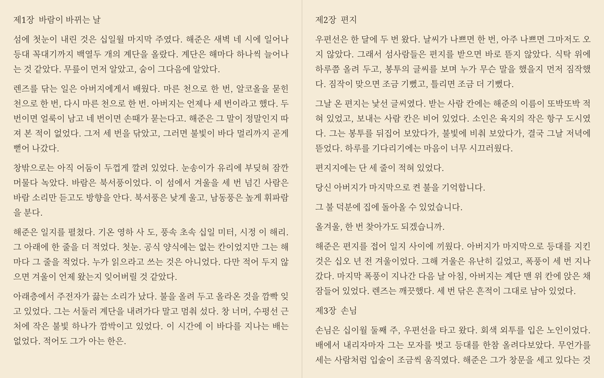
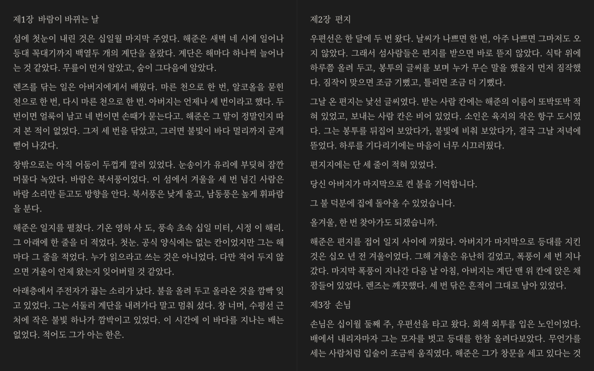
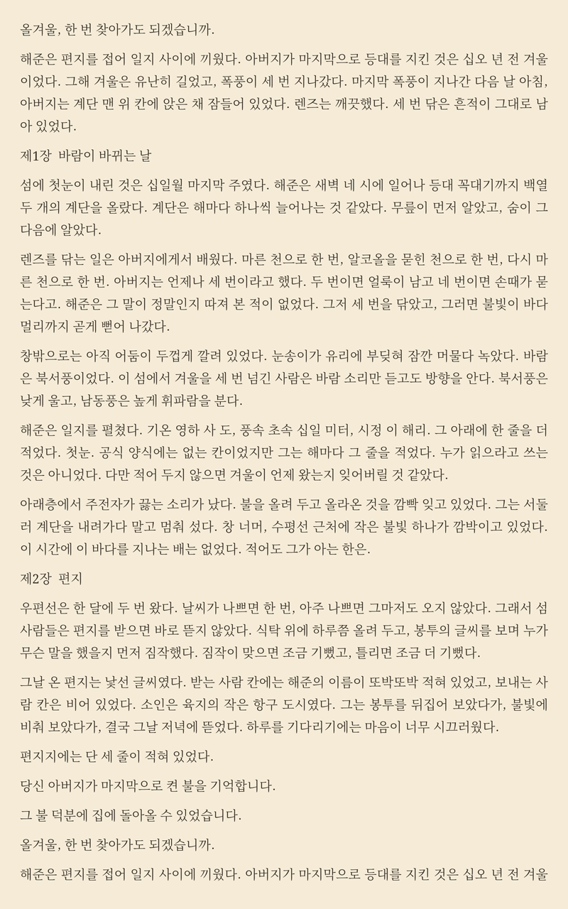
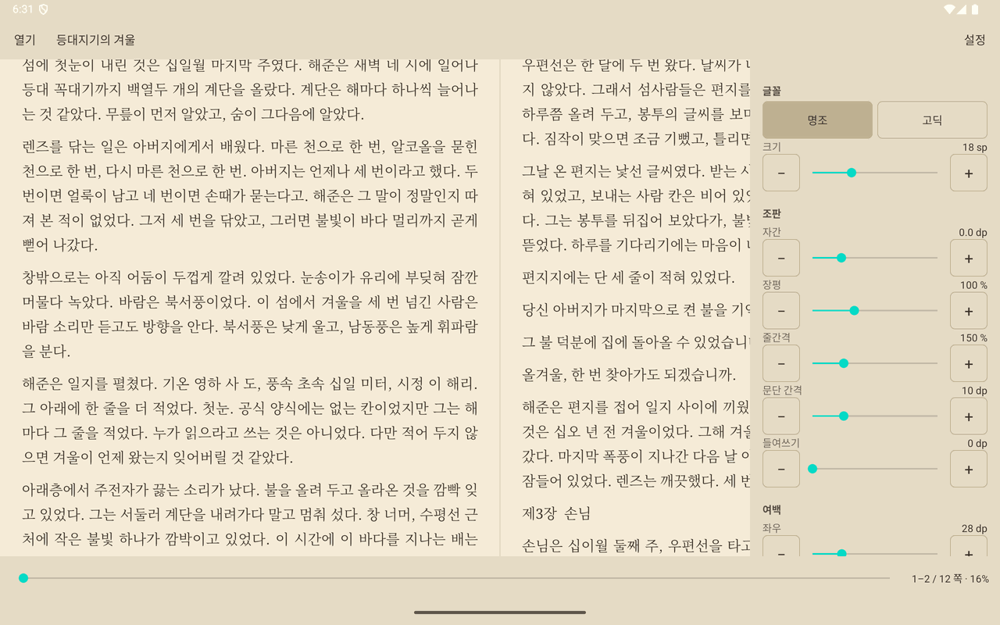
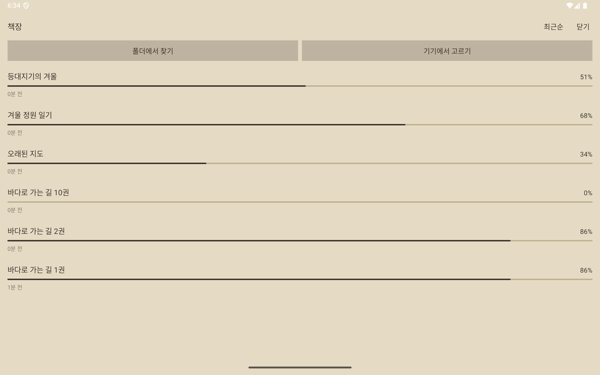
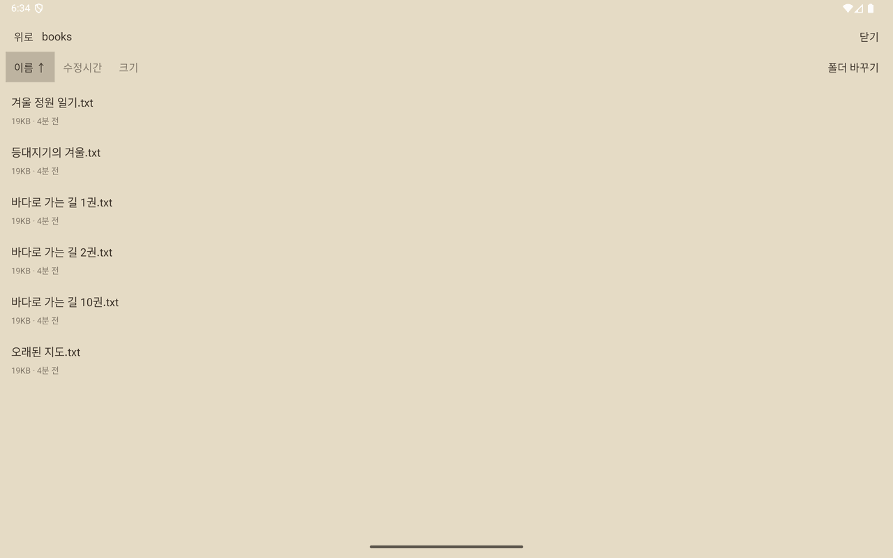

# txtEbook (안드로이드)


안드로이드 태블릿에서 txt 파일을 책처럼 읽는 리더.
한 쪽 또는 두 쪽 펼침으로 보고, 자간·장평·줄간격·여백을 조절한다.



윈도우판(PySide6)을 코틀린으로 다시 만든 것이다.
줄바꿈 판별과 문단 합치기 로직은 그대로 옮겼고, 화면은 터치에 맞게 새로 만들었다.
라이브러리는 AndroidX AppCompat·Material 뿐이고, 조판은 `StaticLayout` 위에 직접 짰다.

## 스크린샷

| 어둠 테마 | 세로 · 한 쪽 보기 |
|:---:|:---:|
|  |  |

| 설정 패널 | 책장 (진행률) | 폴더에서 찾기 (자연 정렬) |
|:---:|:---:|:---:|
|  |  |  |

> 스크린샷은 에뮬레이터(2560×1600 태블릿, API 35)에서 찍었다. 본문은 촬영용으로 새로 쓴 글이다.

## 특징

- **두 쪽 펼침** — 가로에서는 두 쪽, 세로에서는 한 쪽 (직접 고를 수도 있다)
- **세밀한 조판** — 글꼴·크기·자간·장평·줄간격·문단 간격·들여쓰기·여백·양쪽 정렬
- **테마** — 밝음 · 세피아 · 어둠
- **줄바꿈 자동 처리** — 문단이 한 줄인 파일, 단어 단위로 접힌 파일, 글자 수로 잘린 파일을 가려서 문단으로 되살린다
- **인코딩 자동 판별** — UTF-8(BOM 포함), CP949/EUC-KR, UTF-16
- **책장** — 읽던 자리와 진행률을 파일별로 기억한다
- **폴더 브라우저** — 이름(`2권` < `10권`)·수정시간·크기 정렬, 선택은 저장된다
- **두꺼운 책도 빠르게** — 9MB 소설의 첫 쪽이 0.5초, 힙 30MB (아래 [측정값](#측정값-에뮬레이터-25601600-태블릿-api-35-릴리스-빌드))
- 권한 요청 없음, 네트워크 없음 — 파일은 SAF(저장소 접근 프레임워크)로만 연다

## 설치

[Releases](../../releases) 에서 `app-release.apk` 를 받거나, 직접 빌드한다 ([빌드](#빌드)).

태블릿에 복사해서 실행하거나, USB로 연결해 `adb install app-release.apk`.
스토어를 거치지 않으므로 "출처를 알 수 없는 앱" 설치를 한 번 허용해야 한다.

## 쓰는 법

읽는 동안에는 화면에 지면만 남는다. 위·아래 막대도, 안드로이드 상태 표시줄과 제스처 바도 물러난다.

- **막대 꺼내기** — 지면 **가운데**를 누르면 막대가 다 같이 올라오고, 3초 뒤 스스로 사라진다.
  이동 바를 끄는 동안과 설정이 열려 있는 동안에는 사라지지 않는다.
  떠 있을 때 가운데를 다시 누르면 **설정 패널까지 한 번에 접힌다.**
- **넘기기** — 지면 **왼쪽 1/4** 이 이전, **오른쪽** 이 다음이다. 좌우로 밀어도 된다.
  이전을 좁게 둔 것은 실수로 되돌아가지 않게 하기 위해서다.
- **열기** — 막대를 꺼내 `열기` 를 누르면 **책장**이 열린다. 한 번 연 책은 여기에 꽂히고, 제목 옆에
  몇 퍼센트까지 읽었는지 나온다. 줄 세우는 방식(최근순·제목순·진행률순)은 오른쪽 위 버튼으로 바꾸고,
  앱을 닫아도 그대로 남는다. 책을 길게 누르면 책장에서 뺀다 (파일은 지우지 않는다).
- **폴더에서 찾기** — 책이 담긴 폴더를 한 번 지정해 두면(권한은 저장된다) 그 안의 txt 목록을 앱이
  직접 보여 준다. `이름 · 수정시간 · 크기` 를 누르면 그것으로 줄 세우고, 같은 것을 다시 누르면
  오름/내림이 뒤집힌다. **이 선택은 앱을 닫아도 남는다.** 이름은 사람이 세는 순서다 (`2권` 이
  `10권` 보다 앞). 하위 폴더로 들어갈 수 있고, 마지막으로 보던 폴더에서 다시 열린다.
- **기기에서 고르기** — 한 파일만 열 때. 기기의 문서 화면이 뜬다. 파일 관리자에서 txt를 눌러
  이 앱으로 열어도 된다.
  책이 없을 때는 막대가 사라지지 않는다.
- **먼 곳으로** — 아래쪽 이동 바를 누르거나 끈다.
- **설정** — 오른쪽 위 `설정`. 가로에서는 오른쪽에, 세로에서는 아래에서 열린다.
- **뒤로 가기** — 설정이 열려 있으면 닫고, 막대가 떠 있으면 감추고, 아니면 앱을 닫는다.

읽던 자리는 파일별로 저장된다. 조판을 바꾸거나 화면을 돌려도 읽던 자리를 지킨다.

## 설정 항목

| 항목 | 범위 | 한 눈금 |
|---|---|---|
| 글꼴 | 명조 / 고딕 | — |
| 크기 | 8 ~ 40 sp | 1 |
| 자간 | -1.5 ~ 5.0 dp | 0.1 |
| 장평 | 50 ~ 200 % | 1 |
| 줄간격 | 100 ~ 300 % | 1 |
| 문단 간격 | 0 ~ 40 dp | 1 |
| 들여쓰기 | 0 ~ 60 dp | 1 |
| 여백 좌우·상하 | 0 ~ 120 dp | 1 |

두 쪽 보기에서는 '좌우' 값이 가운데 간격에도 적용된다 (쪽마다 안쪽에도 같은 여백이 붙어 간격은 두 배).

슬라이더 양옆의 `−` `+` 가 미세조정 버튼이다. 그 밖에 한 쪽/두 쪽, 테마(밝음·세피아·어둠),
양쪽 정렬, 줄바꿈 처리(자동·원문 그대로·문단으로 합치기)를 고를 수 있다.

## 줄바꿈 처리

txt 파일은 줄바꿈 방식이 제각각이라 그대로 보여 주면 줄이 들쭉날쭉해진다.
`자동`은 파일을 보고 세 가지로 나눠 처리한다.

- **문단이 한 줄인 파일** — 그대로 둔다. 합치면 글이 다 뭉개진다.
- **단어 단위로 접힌 파일** — 줄을 이으면서 줄바꿈이 삼킨 띄어쓰기를 되살린다.
- **글자 수·바이트 수로 잘린 파일** — 단어 중간에서 끊겼으므로 그대로 붙인다.

문단 경계는 빈 줄로 찾고, 빈 줄이 없는 파일은 *다음 줄 첫 단어가 들어갈 자리가
남아 있었는지*로 가른다. 자리가 남았는데도 줄이 넘어갔다면 줄바꿈이 아니라
글쓴이가 문단을 끊은 것이다.

인코딩은 UTF-8(BOM 포함), CP949/EUC-KR, UTF-16을 자동으로 알아본다.

## 구조

| 파일 | 하는 일 |
|---|---|
| `TextPrep.kt` | 줄바꿈 판별, 문단 합치기, 표시 폭 (윈도우판에서 이식) |
| `Encoding.kt` | 인코딩 자동 판별 |
| `Paginator.kt` | 페이지 나누기, 글자 위치 ↔ 쪽 번호 |
| `PageCache.kt` | 세어 둔 쪽 표 저장 (같은 책·같은 설정이면 조판을 건너뛴다) |
| `ReaderView.kt` | 지면 그리기, 조판 설정 적용, 터치 |
| `SettingsPanel.kt` | 설정 패널 (지면 위에 겹치는 오버레이) |
| `Bookshelf.kt` | 읽던 책 목록 (진행률·정렬) |
| `FolderBrowser.kt` | 폴더 안의 txt 목록 (이름·수정시간·크기 정렬, 저장됨) |
| `Folder.kt` | 폴더 목록 줄 세우기 (저장소를 타지 않는 순수 함수) |
| `NaturalOrder.kt` | 이름을 사람이 세는 순서로 견주기 (`2권` < `10권`) |
| `Settings.kt` | 설정값, 책장(읽던 자리·글자 수·마지막으로 읽은 때) 저장 |
| `MainActivity.kt` | 화면 조립, 파일 열기(SAF), 페이지 바 |

### 조판에서 지켜야 하는 것들

윈도우판을 만들며 실제로 겪고 고친 문제들이다. 건드릴 때 주의.

- **앵커 대칭성** — `Paginator.charAt()` 과 `pageOf()` 는 반드시 같은 줄 단위로 맞물려야 한다.
  한쪽만 어긋나면 설정을 만질 때마다 페이지가 한 장씩 뒤로 밀린다.
- **앵커는 페이지를 넘길 때만 갱신** — 조판을 바꿀 때마다 다시 계산하면 조금씩 누적으로 밀린다.
- **페이지 클립은 실제 내용 높이로** — 지면 높이로 자르면 남는 자리로 다음 줄 윗부분이 비쳐서
  줄이 반쯤 잘려 보인다 (`pageContentHeight`).
- **줄 높이는 span 으로 못박는다** — 안드로이드는 줄마다 그 줄에 쓰인 글꼴의 metrics 로 높이를
  정해서, 영문이 섞인 줄만 넓어진다. 배율(`setLineSpacing`)을 쓰면 그 차이까지 곱해진다.
- **span 은 문단마다 달지 않는다** — `SpannableString` 의 span 조회는 선형 검색이고 `StaticLayout` 은
  그것을 문단마다 부른다. 문단마다 span 을 달면 O(문단²) 이 되어, 문단이 수만 개인 책은 조판이
  끝나지 않는다 (문단 4.7만 개짜리 3.2MB 책에서 메인 스레드 38초 후 ANR). `ParagraphMetrics` 는
  본문 전체에 하나만 걸고, 문단 경계는 줄 끝의 개행으로 가른다.
- **책을 통째로 조판하지 않는다** — `StaticLayout` 하나에 책 전체를 넣으면 9MB 책에서 13초가 걸리고
  힙을 188MB 쓴다 (한도 192MB). 조금만 더 두꺼우면 그대로 죽는다. `Paginator` 는 본문을 20만 자
  덩어리로 잘라 차례로 조판하고, 그리기용 레이아웃은 두 개만 들고 있는다. 같은 책이 5.8초 · 30MB 로
  줄고, 첫 쪽은 0.5초 만에 나온다. 덩어리는 **반드시 문단 경계에서** 자른다. 문단이 걸치면 줄
  나눔이 달라진다. 대신 덩어리 끝마다 덜 찬 쪽이 한 장 생긴다 (400쪽에 한 번꼴).
- **문단 사이 빈 줄은 버린다** — 문단마다 빈 줄을 넣는 웹소설 파일이 흔한데, 그대로 두면 빈 줄까지
  한 줄씩 조판돼 조판할 줄이 두 배가 된다 (9MB 책에서 24만 줄 → 13.6만 줄). 화면에서도 문단 간격과
  겹쳐 두 번 벌어진다. 문단 사이는 '문단 간격' 설정이 그린다. `원문 그대로` 모드는 빈 줄을 지킨다.
- **본문 정리도 워커에서 한다** — `buildParagraphs` 는 9MB 책에서 0.5~1.5초가 걸린다. UI 스레드에서
  하면 파일을 여는 동안 손가락에 아무 반응이 없다.
- **조판은 백그라운드에서 한다** — 두꺼운 책은 `StaticLayout` 을 짜는 데 몇 초가 걸린다.
  메인 스레드에서 하면 회전·설정 변경 때마다 화면이 그만큼 얼어붙는다. 워커에 넘길 값
  (본문 span, paint **복사본**, 지면 크기)은 UI 스레드에서 미리 다 만들어 넘긴다. `settings` 와
  `textPaint` 는 UI 스레드가 계속 고치므로 워커가 직접 보면 안 된다.
- **한 번 센 쪽 표는 적어 둔다** — 조판 결과는 본문과 조판 설정이 같으면 언제나 같다.
  `PageCache` 가 쪽 표(쪽마다 정수 하나, 7,299쪽에 29KB)를 `filesDir/pages` 에 적어 두고, 다음에
  열 때 그대로 쓴다. 이름표에는 **조판에 영향을 주는 값이 빠짐없이** 들어가야 한다 (책 주소,
  본문 길이·해시, 글꼴·크기·자간·장평, 줄간격, 문단 간격, 들여쓰기, 양쪽 맞춤, 지면 크기).
  하나라도 빠뜨리면 낡은 쪽 표를 꺼내 써서 글자와 쪽이 어긋난다. 꺼낸 표는 `Paginator.restore()`
  가 다시 한 번 본다 — 0 에서 시작해 본문 안에서 계속 늘어나야 받아들인다.
- **그릴 때는 그 쪽에 들어갈 글자만 조판한다** — 쪽을 세는 일(덩어리 단위)과 그리는 일을 갈라
  놓는다. 한때는 덩어리(20만 자) 하나를 통째로 조판해 두고 그 안에서 한 쪽을 떼어 그렸는데,
  실기기(SM-T320)에서 덩어리 하나가 **5.6초**였다. 책을 열 때도, 덩어리를 넘어갈 때도 그만큼
  지면이 비어 있었다. 지금은 지면 하나(수백~수천 자)만 짜므로 **10~40ms** 다.
- **떼어 짜도 줄 나눔이 같아야 한다** — 안드로이드의 기본 줄 나눔은 앞에서부터 채우는
  방식(greedy)이라, **줄이 시작하는 자리**에서 잘라 다시 짜면 같은 자리에서 끊긴다. 쪽의 첫 글자는
  언제나 줄 시작이다. 여기에 두 가지를 더 맞춘다. (1) 지면 끝을 400자쯤 넘겨서 짠다 — 끝에서 딱
  끊으면 마지막 줄이 문단 끝인 줄 알고 양쪽 맞춤이 풀린다. (2) 문단 가운데서 시작하는 지면은 첫 줄
  들여쓰기를 지운다 — 안 지우면 들여쓴 만큼 폭이 줄어 줄 나눔이 달라진다. 계측 테스트가 쪽마다
  **통째로 조판한 것과 픽셀까지 같은지** 본다.
- **조판 요청에는 번호를 붙인다** — 조판은 도중에 멈출 수 없다. 뒤늦게 끝난 옛 요청이 새 조판을
  덮어쓰지 않도록 번호(`generation`)를 함께 보내고, 돌아왔을 때 번호가 다르면 결과를 버린다.
- **설정 변경 중에는 옛 지면을 그대로 둔다** — 새 조판이 올 때까지 화면을 비우면 슬라이더를
  만질 때마다 `조판 중…` 으로 깜빡인다. 지면 크기나 본문이 달라진 때(회전·줄바꿈 방식 변경)만
  치운다. 폭이 안 맞는 옛 조판을 그리면 어긋나 보이기 때문이다.
- **설정 변경은 디바운스** — 슬라이더를 끌면 값이 쉬지 않고 들어온다. 180ms 모아서 한 번만 조판한다.
- **막대와 설정 패널은 지면 위에 겹친다** — 레이아웃 자리를 차지하면 여닫을 때마다 지면 크기가
  바뀌어 재조판이 일어나고 읽던 쪽이 달라진다. 지면은 늘 화면 전체를 쓴다.
- **`setDecorFitsSystemWindows(false)` 를 직접 부른다** — 안드로이드 14 이하에서는 시스템이
  상태 표시줄 자리만큼 콘텐츠 뷰에 패딩을 넣는다. 그러면 막대를 여닫아 시스템 막대가 나타나고
  사라질 때마다 지면 높이가 24px 씩 오르내려 책 전체가 다시 조판된다 (탭 S6·3.2MB 책에서
  탭 한 번에 5.7초 × 2회). 안드로이드 15 부터는 targetSdk 35+ 앱의 기본값이라 증상이 안 보인다.
- **여백도 종이다** — 종이색은 화면 전체에 깔고 그 위에 글자를 얹는다. 여백만 바탕색으로 남기면
  여백이 아니라 지면이 좁아진 것처럼 보인다. 두 쪽 보기의 가운데 선은 종이를 다 깔고 나서 긋는다.
- **가운데 간격은 좌우 여백을 따른다** — 쪽마다 안쪽에도 바깥과 같은 여백을 줘야 네 변이 고르게
  보인다 (`ReaderView.gutter()`). 조판(`pageBox`)과 그리기가 반드시 같은 값을 써야 한다. 여백을
  0 까지 줄여도 가운데 선이 글자를 물지 않게 최소 8dp 는 남긴다.
- **진행률은 쪽이 아니라 글자로 센다** — 글자 크기나 여백을 바꾸면 쪽수가 통째로 달라진다.
  책장의 `45%` 는 `읽던 글자 위치 / 본문 글자 수` 다. 본문 글자 수는 책을 열어 봐야 알 수 있어서,
  한 번도 안 연 책은 `—` 로 둔다.
- **고르기 화면에 형식을 하나만 넘긴다** — `arrayOf("text/plain", "*/*")` 처럼 여럿을 넘기면
  고르기 화면에 `형식` 칸이 하나 더 붙는다. 와일드카드 하나만 넘긴다. `text/plain` 으로 좁히면
  형식이 엉뚱하게 붙어 오는 txt 파일이 아예 안 보인다.
- **기기의 고르기 화면은 앱이 꾸밀 수 없다** — 열 때마다 정렬(이름·수정시간, 오름/내림)이 기본값으로
  돌아가고, `이름·형식·크기·수정 시간` 열도 그 화면(DocumentsUI)의 것이라 앱에서 지우거나 기억시킬
  수 없다. 앱이 넘길 수 있는 것은 형식 목록과 `EXTRA_INITIAL_URI`(시작 폴더)뿐이다. 그래서 **폴더
  권한을 한 번 받아 두고**(`ACTION_OPEN_DOCUMENT_TREE`) 목록을 우리가 그린다. 그러면 정렬을 우리가
  저장할 수 있고, 형식 열도 없고, 어디까지 읽었는지도 같이 보여 줄 수 있다.
- **파일 이름은 사람이 세는 순서로 줄 세운다** — 글자 그대로 견주면 `2권` 이 `10권` 보다 뒤로 간다.
  연재물은 이름에 번호가 들어가므로 숫자는 값으로 견준다 (`NaturalOrder.kt`).
- **레이아웃 도중에 글자를 바꾸지 않는다** — 조판은 레이아웃 안에서 끝나기도 한다. 그 안에서
  라벨 텍스트를 바꾸면 `requestLayout` 이 무시돼 폭이 0 인 채로 남는다.

## 테스트

```
gradlew test                      # 줄바꿈·문단·인코딩·책장·폴더 정렬 (47건, 기기 불필요)
gradlew connectedAndroidTest      # 조판 엔진·쪽 표 (20건, 기기/에뮬레이터 필요)
```

계측 테스트는 앵커 왕복, 지면 넘침, 줄 나눔, 조판 변경 후 위치 유지, 쪽 표 재사용, 대용량 성능을 본다.

기기에 앱이 깔려 있으면 서명이 달라 계측 테스트 설치가 막힌다 (`INSTALL_FAILED_UPDATE_INCOMPATIBLE`).
`adb uninstall com.txtebook` 으로 지우고 돌린다. **앱 데이터(읽던 자리·설정)도 같이 지워진다.**

## 빌드

```
gradlew assembleDebug             # 개발용
gradlew assembleRelease           # 배포용 (서명됨)
```

JDK 17 과 Android SDK(compileSdk 36)가 필요하다.

릴리스 서명 정보는 저장소에 들어 있지 않다 (`.gitignore` 로 뺐다).
릴리스 APK 를 직접 만들려면 키를 하나 만들고 프로젝트 루트에 `keystore.properties` 를 둔다.

```
keytool -genkeypair -v -keystore txtebook.jks -alias txtebook -keyalg RSA -keysize 2048 -validity 10000
```

```properties
# keystore.properties
storeFile=txtebook.jks
storePassword=...
keyAlias=txtebook
keyPassword=...
```

이 파일이 없으면 릴리스 빌드는 서명 없이 만들어지고(설치 불가), 디버그 빌드는 그대로 동작한다.
키를 잃어버리면 같은 앱의 업데이트를 올릴 수 없으니 저장소 밖에 따로 백업해 둘 것.

## 측정값 (에뮬레이터, 2560×1600 태블릿, API 35, 릴리스 빌드)

9MB 한글 소설 (396만 자, 문단 10.6만 개, 7,299쪽) 기준.

| 항목 | 값 |
|---|---|
| 본문 정리 | 0.5초 |
| **첫 쪽이 나오기까지** | **0.5초** |
| 쪽수 다 세기까지 | 5.8초 (뒤에서 계속 세고, 그동안에도 읽을 수 있다) |
| 힙 사용 | 30MB / 한도 192MB |
| 페이지 넘김 | 즉시 |
| APK 크기 | 4.6MB |

덩어리 조판 이전에는 같은 책이 13초 · 188MB 였다 (한도 192MB 코앞이라 기기에 따라 죽는다).

## 측정값 (실기기 갤럭시탭 3 8.0 · SM-T320, 2014년, API 29)

계측 테스트 기준, 380만 자 · 4,206쪽.

| 항목 | 값 |
|---|---|
| 첫 덩어리 (첫 쪽이 나오기까지) | 0.5초 |
| 쪽수 다 세기까지 | 10.1초 (뒤에서 세고, 그동안에도 읽을 수 있다) |
| 힙 사용 | 26MB / 한도 128MB |

실제 쓰던 책(1.3MB, 3,169쪽)을 다시 열 때 (앱 로그 기준):

| 항목 | 값 |
|---|---|
| 본문 정리 | 0.5초 |
| 쪽 표 읽어 오기 | 22ms (조판을 통째로 건너뛴다) |
| 첫 지면 조판 | 27ms |
| 페이지 넘김 | 10~40ms |

10년 된 보급형 태블릿이라 에뮬레이터보다 두 배 가까이 느리다. 지면 하나만 조판하도록 바꾸기 전에는
같은 책을 여는 데 5.7초가 걸렸다 (쪽 표를 건너뛰고도 덩어리 하나를 짜느라 5.6초).

## 남은 일

- 실기기 터치 감·배터리 확인 (성능은 SM-T320 에서 확인함)
- 책장에서 책을 검색하거나 폴더로 묶기 (지금은 60권까지 한 줄로 늘어놓는다)
- 한글 글꼴 번들 — 지금은 기기에 있는 명조/고딕을 쓴다. 기기마다 글꼴이 달라 보일 수 있다.
- 처음 여는 책은 읽던 자리까지 조판이 와야 화면이 뜬다 (9MB 책 끝부분이면 5초쯤). 두 번째부터는
  적어 둔 쪽 표로 건너뛴다. 읽던 덩어리부터 조판하면 첫 번째 기다림도 없앨 수 있다.
- 본문 정리(`buildParagraphs`) 는 열 때마다 다시 한다 (9MB 책 0.5~1.5초). 쪽 표처럼 적어 둘 수
  있지만 본문만큼 자리를 차지한다.
- 막대가 떠 있는 동안에는 지면의 첫 줄과 마지막 줄을 가린다. 지면이 늘 화면 전체를 쓰기 때문인데,
  이건 막대를 여닫을 때마다 책이 다시 조판되지 않게 하려고 택한 것이다.
